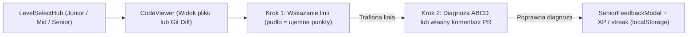

# ReviewTheGame


Przeglądarkowa gra edukacyjna do ćwiczenia **Code Review** i analizy diffów Pull Requestów — zamiast pisania algorytmów od zera gracz szuka błędów, regresji i luk bezpieczeństwa w gotowym kodzie.

> **Metodyka powstania:** Projekt jest eksperymentem zrealizowanym w podejściu **vibecoding** (szybkie prototypowanie wspomagane narzędziami AI). Odpowiadałem za wizję produktu, mechanikę rozgrywki, dobór scenariuszy oraz iteracje UI/UX.

---

## Mechanika rozgrywki

Aby wyeliminować bezmyślne klikanie wariantów ABCD, każde wyzwanie wymaga przejścia dwóch kroków przed zobaczeniem wyjaśnienia:



---

## Zakres obecnego MVP

Bieżąca wersja działa całkowicie po stronie przeglądarki (bez backendu) i zawiera:

- **9 wyzwań podzielonych na 3 poziomy trudności** ([`src/data/challenges.ts`](src/data/challenges.ts)):
  - **Junior** (widok pliku): zasięg `var`, luźne porównanie `==`, brakujący `return`.
  - **Mid** (widok Git Diff): niejawna mutacja tablicy, brakujące `await`, nieobsłużone `JSON.parse`.
  - **Senior** (widok Git Diff): usunięta kontrola autoryzacji (IDOR), podatność SQL Injection w klauzuli `LIKE`, race condition przy aktualizacji salda portfela.
- **Dwuetapowa detekcja:** opcje diagnozy są ukryte do czasu kliknięcia właściwej linii kodu; błędne strzały odejmują punkty.
- **Komentarz PR (tryb tekstowy):** komponent [`AiReviewModal.tsx`](src/components/AiReviewModal.tsx) (`evaluateReviewComment`) ocenia wpisany komentarz lokalnie na podstawie słów kluczowych przyczyny błędu i propozycji poprawki (deterministyczny matcher offline, bez zewnętrznego API LLM).
- **Wielojęzyczność i Playbook:** przełącznik języka interfejsu (`PL` / `EN`), niezależny przełącznik języka komentarzy w kodzie, zakładka zasad Code Review ([`PlaybookView.tsx`](src/components/PlaybookView.tsx)) oraz zapis postępów w `localStorage`.

---

## Decyzje i kompromisy

| Wyzwanie | Rozwiązanie w MVP | Kompromis |
|---|---|---|
| **Zgadywanie odpowiedzi ABCD bez czytania kodu** | Warianty diagnozy są zablokowane do momentu wskazania podejrzanej linii, a pomyłki odejmują punkty. | Wymaga ręcznego zdefiniowania dokładnych numerów linii dla każdego scenariusza. |
| **Brak backendu i kluczy API w wersji statycznej** | Persystencja w `localStorage` oraz lokalny ewaluator komentarzy oparty o `aiKeywords.cause` i `aiKeywords.fix`. | Zero kosztów hostingu i konfiguracji po stronie użytkownika, kosztem ograniczonej oceny semantycznej względem prawdziwego LLM. |

---

## Szybki start

Wymagany **Node.js** (np. v20+) oraz `npm`:

```bash
npm install
npm run dev
```

Aplikacja uruchomi się lokalnie pod adresem `http://localhost:5173`. Budowanie wersji produkcyjnej z weryfikacją TypeScriptu:

```bash
npm run build
```

---

## Dokumentacja wizji produktu

Szersze założenia, planowane tryby społecznościowe i dalsze pomysły rozwoju zostały spisane w [`PROJECT_CONTEXT.md`](PROJECT_CONTEXT.md).
